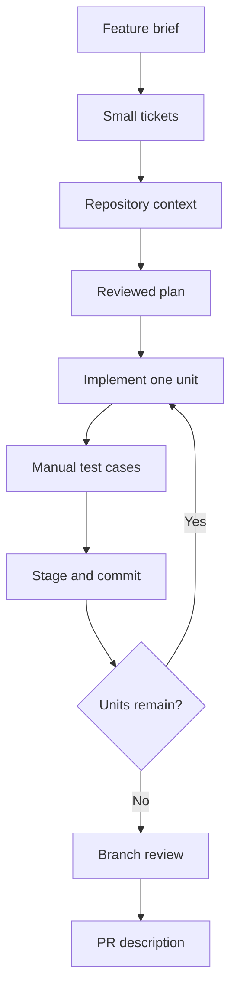

# Skill examples

[Back to the README](README.md)

After [installation](README.md#installation-instructions), use these prompts in
your target repository. The invoice application, paths, and outputs are
illustrative; no examples were executed.

- [Chain skills from a feature brief to delivery](#chain-skills-from-a-feature-brief-to-delivery)
- [Plan, review, and describe a change](#plan-review-and-describe-a-change)
- [Investigate feasibility](#investigate-feasibility)
- [Prepare manual test cases](#prepare-manual-test-cases)
- [Draft a commit message](#draft-a-commit-message)

## Chain skills from a feature brief to delivery

Split a request for invoice PDFs and monthly CSV exports into separate tickets,
then take the PDF ticket through delivery. Each row is a separate request;
inspect its result before continuing. Start at any step whose input you have.



### Shape and plan the work

| Step | Example request | Result passed to the next step |
| --- | --- | --- |
| 1. [requirements-to-tickets](.agents/skills/scoping/requirements-to-tickets/SKILL.md) | Use requirements-to-tickets to split this brief into focused tickets and save them as Markdown: customers can download their own invoice PDFs and export a monthly invoice list as CSV. Exclude bulk PDF downloads. | Separate PDF and CSV tickets with acceptance criteria and explicit dependencies, if any. Select the PDF ticket for the following steps. |
| 2. [ticket-context](.agents/skills/scoping/ticket-context/SKILL.md) | Use ticket-context for the PDF ticket at `<ticket-file>`. Explain invoice ownership, the existing invoice page, and the relevant code paths. | A context brief with repository evidence and unresolved questions. |
| 3. [ticket-to-plan](.agents/skills/scoping/ticket-to-plan/SKILL.md) | Use ticket-to-plan for `<ticket-file>`, using `<context-file>` as supporting context. Keep monthly CSV export outside this plan. | After confirmation, a planning README and phase files, checked with [plan-review](.agents/skills/review/plan-review/SKILL.md). |

Replace `<placeholders>` with paths reported by earlier steps. Default Markdown
outputs live under `<repo-root>/<branch-slug>/<skill-name>/`; see
[output configuration](README.md#configuration) for alternatives. Stay in the
same repository and branch, or supply earlier artifact paths explicitly.

### Implement and deliver

Create or switch to a feature branch before implementation; `next-commit`
pauses on `main` or `master` and does not switch branches for you.

| Step | Example request or action | Result passed to the next step |
| --- | --- | --- |
| 4. [next-commit](.agents/skills/implementation/next-commit/SKILL.md) | Use next-commit with `<planning-readme>`. | Exactly one unchecked unit implemented and validated, with local plan progress updated. No Git commit is created. |
| 5. [test-cases](.agents/skills/scoping/test-cases/SKILL.md) | Use test-cases for the current branch against main, using `<ticket-file>` and `<planning-readme>`. Focus on the implemented PDF flows. | Prioritized manual cases covering the committed and local changes. Execute applicable cases separately and record actual results. |
| 6. Stage and commit | Inspect and stage the completed implementation unit. Ask: Use commit-message for my staged changes. Then create the commit yourself or explicitly ask the agent to commit. | A committed implementation unit. Leave ticket and plan progress out of implementation commits unless intentionally included. |
| 7. Finish the plan | Repeat steps 4–6 until the scoped plan is complete. | All implementation units validated and committed; manual cases updated as the behavior grows. |
| 8. [review-branch](.agents/skills/review/review-branch/SKILL.md) | Use review-branch against main, using `<ticket-file>` and `<planning-readme>` as the specification. | Actionable findings or `No issues found.` Review covers committed changes only. Address findings and commit fixes before repeating the review. |
| 9. [pr-description](.agents/skills/productivity/pr-description/SKILL.md) | Use pr-description for the completed PDF change, using the ticket, committed diff, review findings, and recorded validation results. | A copy-ready description grounded in the delivered behavior and checks actually performed. |

These steps do not push changes or publish a PR.

## Plan, review, and describe a change

### Turn a ticket into an implementation plan

[ticket-to-plan](.agents/skills/scoping/ticket-to-plan/SKILL.md) inspects the
repository, asks for confirmation, writes and reviews the plan, then stops
before implementation.

**Before:** A ticket says what users need, but leaves the implementation and
validation unclear.

> Use ticket-to-plan for this ticket: Customers need to download their invoices
> as PDFs. Only the invoice owner may download one. Keep the existing invoice
> page behavior intact and exclude bulk downloads.

**After:** A planning overview and phase files. Phase excerpt:

```markdown
## Phase 1: Owner-only invoice PDF download

- [ ] Add the download endpoint using the existing invoice ownership check.
- [ ] Generate the PDF from the authorized invoice and expose the download link.
- [ ] Verify owner access, denied access for another customer, and PDF contents.

Exit criteria: Owners can download their invoices; other customers cannot.
```

### Review a branch before merging

[review-branch](.agents/skills/review/review-branch/SKILL.md) checks committed
changes against requirements. Review is static; request test execution separately.

**Before:** A branch is ready for review, but a successful download test could
still miss an authorization defect.

> Use review-branch to review this committed branch against main. The invoice
> download must be restricted to its owner.

**After:** An actionable finding with evidence and a fix:

| Severity | Finding | Location | Why it matters | Recommended action | PR comment: issue summary and fix options |
| --- | --- | --- | --- | --- | --- |
| Critical — fix before merge | Another customer can download the invoice | `app/invoices/download.py:24` | The lookup uses only the invoice ID, so a signed-in customer can request another customer's PDF. | Apply the existing ownership check before generating the PDF. | The download lookup does not check invoice ownership. A customer who supplies another invoice ID can retrieve its PDF. Scope the lookup to the current customer or apply the existing ownership check before generation. |

### Write a useful PR description

[pr-description](.agents/skills/productivity/pr-description/SKILL.md) drafts a
copy-ready description using “MR” terminology and copies it to the clipboard.

**Before:** A change summary says only “add PDF endpoint and tests.”

> Use pr-description for this change: Invoice owners can now download a PDF
> from the invoice page. Previously they had to request one from support.
> The endpoint checks ownership before generating the PDF. Owner and non-owner
> access tests passed; bulk downloads are excluded.

**After:** A description explaining the problem, cause, and fix:

```markdown
This MR lets customers download their own invoices as PDFs.

## The problem

Customers had to contact support to get a PDF invoice.

## The cause

The invoice page offered no PDF download.

## The fix

Add a download link and check ownership before generating the PDF. Owner and
non-owner access tests passed. Bulk downloads remain outside this change.
```

## Investigate feasibility

[quick-plan](.agents/skills/scoping/quick-plan/SKILL.md) investigates unknowns
blocking a build decision.

**Before:** The team does not know whether its current PDF tooling is suitable.

> Use quick-plan to investigate whether our existing PDF renderer can support
> customer invoice downloads. Check deployment constraints and the current
> rendering path. Exclude bulk downloads and do not implement anything.

**After:** Evidence and one recommendation: proceed, turn the work into tickets,
or abandon. Example when the renderer meets the requirements:

> Recommendation: requirements-to-tickets. The existing renderer supports the
> invoice layout and runs in the current deployment environment. Scope an
> owner-only download ticket and carry renderer failure handling into its
> acceptance criteria.

Pass findings and unresolved questions to `requirements-to-tickets`.

## Prepare manual test cases

[test-cases](.agents/skills/scoping/test-cases/SKILL.md) produces executable
manual checks for changed flows.

**Before:** “Test invoice downloads” leaves the actor, data, and expected result
unclear.

> Use test-cases for this branch against main and the PDF ticket at
> `<ticket-file>`. Our local test environment has two customer accounts with
> one invoice each. Focus on the download flow and ownership boundary.

**After:** Prioritized cases with setup, actions, expected results, and gaps.
Case excerpt:

- **Priority:** P0 — access control.
- **Setup:** In the local test environment, customers A and B each own an invoice.
  Record B's invoice download URL using the test fixture or B's session.
- **Actions:** Sign in as A and request B's invoice download URL.
- **Expected:** Access is denied and no PDF or invoice details are returned.
- **Evidence:** Record the response status and confirm that the body contains no
  invoice data. End the test session afterward.

Run the cases against the intended build before recording pass/fail results.

## Draft a commit message

Use [commit-message](.agents/skills/productivity/commit-message/SKILL.md) once
implementation changes are staged.

**Before:** The staged diff adds an owner-only PDF download; an unrelated invoice
page edit is still unstaged.

> Use commit-message to draft a message for my staged changes.

**After:** A message covering only the staged change:

```text
Add owner-only invoice PDF downloads
```

The skill neither stages files nor commits; use it after staging a completed
`next-commit` unit.
