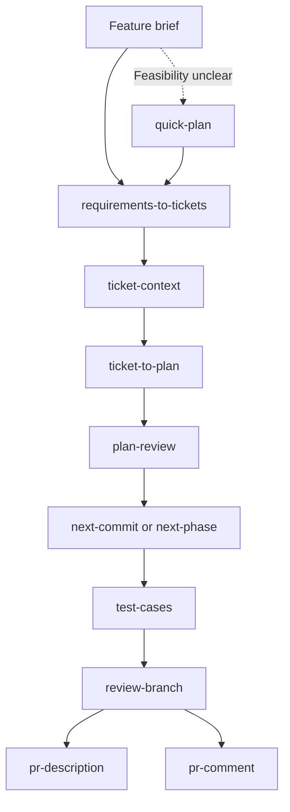

# agent-toolkit

agent-toolkit provides installable skills for concise communication, coding
standards, planning, implementation, and review, with support for Claude and Codex.

## Quick start

**Prerequisites:** Git, Bash, Make, `shasum`, and an installed, signed-in Codex or
Claude Code client. Run the following in a macOS or Linux terminal:

```bash
git clone https://github.com/EimantasZilis/agent-toolkit.git
cd agent-toolkit
make install
```

Choose a provider and skills, then review the proposed changes. Keep this clone:
supporting files link back to it. For options and maintenance, see
[INSTALL.md](INSTALL.md).

Start a new session and try `$concise-output` in Codex or `/concise-output` in
Claude Code. See the [worked examples](EXAMPLES.md) for sample prompts.

## Highlights

- **Clear writing:** plain English answers and documentation, with details
  introduced gradually.
- **Coding standards:** guidance for Python, JavaScript, TypeScript, Go,
  Ruby/Rails, and Bash.
- **Planning:** feasibility checks, tickets, and implementation plans.
- **Implementation:** one planned unit or a full phase at a time.
- **Review:** code review, security assessment, and manual test cases.

## Skill catalog

| Category | Pack | Purpose |
| --- | --- | --- |
| coding | [bash-standards](.agents/skills/coding/bash-standards/SKILL.md) | Routed Bash engineering guidance. |
| coding | [define-coding-standards](.agents/skills/coding/define-coding-standards/SKILL.md) | Build a language standards pack. |
| coding | [golang-standards](.agents/skills/coding/golang-standards/SKILL.md) | Routed Go engineering guidance. |
| coding | [javascript-standards](.agents/skills/coding/javascript-standards/SKILL.md) | Routed JavaScript engineering guidance. |
| coding | [python-standards](.agents/skills/coding/python-standards/SKILL.md) | Routed Python engineering guidance. |
| coding | [ruby-standards](.agents/skills/coding/ruby-standards/SKILL.md) | Routed Ruby engineering guidance. |
| coding | [ruby-rails-standards](.agents/skills/coding/ruby-rails-standards/SKILL.md) | Routed Ruby on Rails engineering guidance. |
| coding | [typescript-standards](.agents/skills/coding/typescript-standards/SKILL.md) | Routed TypeScript engineering guidance. |
| implementation | [plan-execution-conventions](.agents/skills/implementation/plan-execution-conventions/SKILL.md) | Interpret existing plans, validate completion, and track execution progress. |
| implementation | [next-commit](.agents/skills/implementation/next-commit/SKILL.md) | Implement one planned unit without committing. |
| implementation | [next-phase](.agents/skills/implementation/next-phase/SKILL.md) | Validate and commit each implementation unit locally; keep planning progress uncommitted unless requested. |
| other | [developer-highlights](.agents/skills/other/developer-highlights/SKILL.md) | Evidence-based career narrative from git history. |
| productivity | [commit-message](.agents/skills/productivity/commit-message/SKILL.md) | Short commit message from staged changes and available conversation context. |
| productivity | [concise-output](.agents/skills/productivity/concise-output/SKILL.md) | Readable, concise prose that explains the outcome before the details. |
| productivity | [pr-description](.agents/skills/productivity/pr-description/SKILL.md) | Copy-ready pull-request description. |
| productivity | [pr-comment](.agents/skills/productivity/pr-comment/SKILL.md) | Concise, human response to pull-request feedback. |
| productivity | [to-clipboard](.agents/skills/productivity/to-clipboard/SKILL.md) | Copy the previous response to the clipboard as Markdown. |
| productivity | [to-markdown](.agents/skills/productivity/to-markdown/SKILL.md) | Save the previous response as a formatted Markdown file. |
| review | [plan-review](.agents/skills/review/plan-review/SKILL.md) | Review plan readiness . |
| review | [annotate](.agents/skills/review/annotate/SKILL.md) | Explain branch changes in terminal output without modifying files. |
| review | [review-branch](.agents/skills/review/review-branch/SKILL.md) | Evidence-based review of committed branch changes. |
| scoping | [plan-writing-conventions](.agents/skills/scoping/plan-writing-conventions/SKILL.md) | Define plan structure, scope, validation, and risks. |
| scoping | [quick-plan](.agents/skills/scoping/quick-plan/SKILL.md) | Investigate feasibility and give one recommendation without implementation or a commit plan. |
| scoping | [requirements-to-tickets](.agents/skills/scoping/requirements-to-tickets/SKILL.md) | Turn feature briefs into small, self-contained tickets. |
| scoping | [ticket-context](.agents/skills/scoping/ticket-context/SKILL.md) | Build a repository-backed context brief for a ticket. |
| scoping | [ticket-to-plan](.agents/skills/scoping/ticket-to-plan/SKILL.md) | Turn a file, chat, or Jira ticket into an implementation-ready planning folder. |
| scoping | [test-cases](.agents/skills/scoping/test-cases/SKILL.md) | Create prioritized Markdown manual test cases for branch changes. |
| security | [security-check](.agents/skills/security/security-check/SKILL.md) | Short fix, accept, or monitor decision. |
| security | [security-review](.agents/skills/security/security-review/SKILL.md) | Detailed security assessment. |

See [CONTRIBUTING.md](CONTRIBUTING.md) for layout and validation rules.

## Chaining skills for software development

Choose the steps your change needs:



- `next-commit` implements one planned unit without committing.
- `next-phase` completes a phase with local commits.
- `review-branch` reviews committed changes.
- Use coding standards and security review where relevant.
- Optional conventions and standards apply when installed; workflows otherwise
  use local defaults and repository guidance.
- PR-writing skills return Markdown. Use `to-clipboard` separately to copy it.

See the [worked workflow](EXAMPLES.md#chain-skills-from-a-feature-brief-to-delivery)
for a full example.

## Guides

See [INSTALL.md](INSTALL.md) for local setup and maintenance, or
[native packages](docs/native-packages.md) for provider plugins. The
[documentation index](docs/README.md) covers publishing, compatibility, and
backend integration.

## Contributing

See [CONTRIBUTING.md](CONTRIBUTING.md) for repository rules. Run `make verify`
to check the catalog, packages, and isolated installations for both providers.
