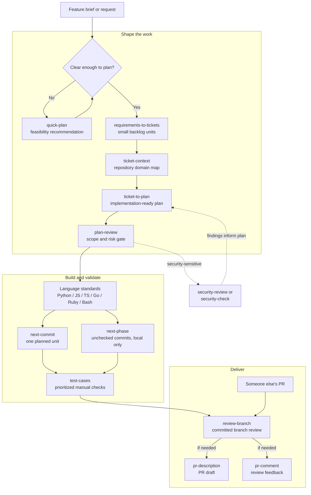

# agent-toolkit

agent-toolkit provides installable skills for concise communication, coding
standards, planning, implementation, and review, with support for Claude and Codex.

## Quick start

**Prerequisites:** `Git`, `Bash`, and `Make` installed, signed-in Codex or
Claude Code clients. Run the following in a unix terminal:

```bash
git clone https://github.com/EimantasZilis/agent-toolkit.git
cd agent-toolkit
make install
```

When prompted, enter `codex` or `claude` for your client. Press Enter at the
remaining prompts to keep Markdown output repo-local and concise output enabled.
The installer installs the skill catalog and adds managed global guidance for
that provider; see [installation details](#installation-instructions) for paths
and ownership rules. Keep this clone in place: installed supporting files link
back to it.

Check the toolkit's validation and isolated installations for both providers:

```bash
make verify
```

Then start a new Codex or Claude session and send the matching prompt:

```text
$concise-output Rewrite this update in one sentence: We have now completed the work to fix the login issue, and users are once again able to sign in successfully.
```

An example result is:

> The login issue is fixed, and users can sign in again.

Wording may vary; success is a direct, one-sentence update that preserves the
meaning. Try the [worked examples](EXAMPLES.md) next, or choose a skill from
the [catalog](#skill-catalog).

## Highlights

- **Get clearer answers everywhere:** [concise-output](.agents/skills/productivity/concise-output/SKILL.md) leads with the answer, removes repetition, and keeps necessary detail. Recommended for global use.
- **Apply coding standards:** packs for Python, JavaScript, TypeScript, Go, Ruby/Rails, and Bash guide edits and reviews. See [python-standards](.agents/skills/coding/python-standards/SKILL.md) or the [catalog](#skill-catalog).
- **Shape work before coding:** investigate feasibility with [quick-plan](.agents/skills/scoping/quick-plan/SKILL.md), or turn a brief into tickets and a repository-grounded plan with [requirements-to-tickets](.agents/skills/scoping/requirements-to-tickets/SKILL.md) → [ticket-to-plan](.agents/skills/scoping/ticket-to-plan/SKILL.md).
- **Implement in controlled steps:** [next-commit](.agents/skills/implementation/next-commit/SKILL.md) implements and validates one planned unit; [next-phase](.agents/skills/implementation/next-phase/SKILL.md) completes a phase with local commits.
- **Check readiness to merge:** [review-branch](.agents/skills/review/review-branch/SKILL.md) reports actionable findings with evidence; [test-cases](.agents/skills/scoping/test-cases/SKILL.md) prepares prioritized manual checks.
- **Explain the change clearly:** [pr-description](.agents/skills/productivity/pr-description/SKILL.md) drafts the problem and delivered behavior; [commit-message](.agents/skills/productivity/commit-message/SKILL.md) summarizes staged changes.

See the [examples guide](EXAMPLES.md) for prompts, before/after excerpts, and a
workflow from feature brief to PR description.

## Skill catalog

| Category | Pack | Purpose |
| --- | --- | --- |
| coding | [bash-standards](.agents/skills/coding/bash-standards/SKILL.md) | Routed Bash engineering guidance. |
| coding | [define-coding-standards](.agents/skills/coding/define-coding-standards/SKILL.md) | Build a language standards pack. |
| coding | [golang-standards](.agents/skills/coding/golang-standards/SKILL.md) | Routed Go engineering guidance. |
| coding | [javascript-standards](.agents/skills/coding/javascript-standards/SKILL.md) | Routed JavaScript engineering guidance. |
| coding | [python-standards](.agents/skills/coding/python-standards/SKILL.md) | Routed Python engineering guidance. |
| coding | [ruby-standards](.agents/skills/coding/ruby-standards/SKILL.md) | Routed Ruby engineering guidance. |
| coding | [ruby-rails-standards](.agents/skills/coding/ruby-rails-standards/SKILL.md) | Routed Ruby on Rails engineering guidance. |
| coding | [typescript-standards](.agents/skills/coding/typescript-standards/SKILL.md) | Routed TypeScript engineering guidance. |
| implementation | [next-commit](.agents/skills/implementation/next-commit/SKILL.md) | Implement one planned unit without committing. |
| implementation | [next-phase](.agents/skills/implementation/next-phase/SKILL.md) | Validate and commit each implementation unit locally; keep planning progress uncommitted unless requested. |
| other | [developer-highlights](.agents/skills/other/developer-highlights/SKILL.md) | Evidence-based career narrative from git history. |
| productivity | [commit-message](.agents/skills/productivity/commit-message/SKILL.md) | Short commit message from staged changes and available conversation context. |
| productivity | [concise-output](.agents/skills/productivity/concise-output/SKILL.md) | Direct, complete reader-facing prose. |
| productivity | [pr-description](.agents/skills/productivity/pr-description/SKILL.md) | Copy-ready pull-request description. |
| productivity | [pr-comment](.agents/skills/productivity/pr-comment/SKILL.md) | Concise, human response to pull-request feedback. |
| productivity | [to-clipboard](.agents/skills/productivity/to-clipboard/SKILL.md) | Copy the previous response to the clipboard as Markdown. |
| productivity | [to-markdown](.agents/skills/productivity/to-markdown/SKILL.md) | Save the previous response as a formatted Markdown file. |
| review | [plan-review](.agents/skills/review/plan-review/SKILL.md) | Gate plans before implementation. |
| review | [annotate](.agents/skills/review/annotate/SKILL.md) | Explain branch changes in terminal output without modifying files. |
| review | [review-branch](.agents/skills/review/review-branch/SKILL.md) | Evidence-based review of committed branch changes. |
| scoping | [plan-conventions](.agents/skills/scoping/plan-conventions/SKILL.md) | Shared planning and progress rules; exclude planning Markdown from implementation commits unless requested. |
| scoping | [quick-plan](.agents/skills/scoping/quick-plan/SKILL.md) | Investigate feasibility and give one recommendation without implementation or a commit plan. |
| scoping | [requirements-to-tickets](.agents/skills/scoping/requirements-to-tickets/SKILL.md) | Turn feature briefs into small, self-contained backlog tickets. |
| scoping | [ticket-context](.agents/skills/scoping/ticket-context/SKILL.md) | Build a repository-backed context brief for a ticket. |
| scoping | [ticket-to-plan](.agents/skills/scoping/ticket-to-plan/SKILL.md) | Turn a file, chat, or Jira ticket into an implementation-ready planning folder. |
| scoping | [test-cases](.agents/skills/scoping/test-cases/SKILL.md) | Create prioritized Markdown manual test cases for branch changes. |
| security | [security-check](.agents/skills/security/security-check/SKILL.md) | Short fix, accept, or monitor decision. |
| security | [security-review](.agents/skills/security/security-review/SKILL.md) | Detailed security assessment. |

See [CONTRIBUTING.md](CONTRIBUTING.md) for layout and validation rules.

Global coding guidance requires readable spacing across all languages and
standards packs: separate logical groups with blank lines, keep related lines
together, and follow language conventions and the repository's formatter.

## Chaining skills for software development

Chain skills by passing each result to the next step. Follow the
[worked example](EXAMPLES.md#chain-skills-from-a-feature-brief-to-delivery), or
choose the steps your change needs:



Use `next-commit` for one unit or `next-phase` for a full phase. Apply relevant
coding standards and add security review where needed. Commit implementation
changes before `review-branch`, which reviews committed changes only.

## Installation instructions

### Installation

Install and verify:

```bash
make install
make verify
```

Installation paths depend on the provider:

| LLM Provider | Skills | Global config | Provider-specific metadata |
| --- | --- | --- | --- |
| Codex | `${AGENTS_HOME:-~/.agents}/skills/agent-toolkit/` | `${CODEX_HOME:-~/.codex}/AGENTS.md` | Symlinked from `.agents/providers/codex/` |
| Claude | `${CLAUDE_HOME:-~/.claude}/skills/<skill-name>/` | `${CLAUDE_HOME:-~/.claude}/CLAUDE.md` | None |

### How it works

`make install` renders skills for the selected provider and updates its global
guidance. Pre-existing skills with matching names are skipped.

- Each skill gets a provider-rendered `SKILL.md`; supporting files are
  symlinked back to `.agents/skills/`.
- Existing global configuration is preserved. Managed guidance sits between
  `<!-- agent-toolkit:start -->` and `<!-- agent-toolkit:end -->` markers.
- If managed guidance or a skill is edited, it becomes user-owned and is
  preserved on later installs.

### Configuration

`make install` creates `.env` from `.env.template` if needed and prompts for
settings. Defaults are `codex`, repo-local Markdown output, and concise output
enabled. Later installs default to existing values.

| Environment variable | Valid values | Controls |
| --- | --- | --- |
| `LLM_PROVIDER` | `codex`, `claude` | Selects the provider used for installation. |
| `MARKDOWN_OUTPUT_PATH` | blank or an absolute path | Selects repo-local or centralized Markdown artifact storage. |
| `CONCISE_OUTPUT` | `True`, `False` | Enables or disables the `concise-output` skill in the provider's global configuration. |

Skills that write Markdown use the configured output policy unless the user
provides an explicit path. Repo-local artifacts are written to:

```text
<repo-root>/<branch-slug>/<skill-name>/...
```

With `MARKDOWN_OUTPUT_PATH=/absolute/path`, artifacts are written to:

```text
/absolute/path/<repo-slug>/<branch-slug>/<skill-name>/...
```

Repository and branch names are lowercased, unsafe characters become `-`, and
empty slugs fall back to `repo` or `branch`. Detached HEADs use
`detached-<short-sha>`. Markdown artifacts are not automatically committed or
removed by `make uninstall`.

When a skill consumes another skill's Markdown output, it checks an explicit
path first, then the current repository's current-branch producer-skill
directory, then the configured centralized repository/branch/producer-skill
directory, and finally any documented legacy location. Repository-local
lookups are anchored at the Git repository root, not the process working
directory. Skills must not silently cross repository or branch boundaries.

## Uninstall

Remove managed skills and guidance:

```bash
make uninstall
```

Uninstall checks both providers and preserves user-owned skills and global
configuration. It also removes the installer's `.env` file, including one
selected through `AGENT_TOOLKIT_ENV_FILE`.

