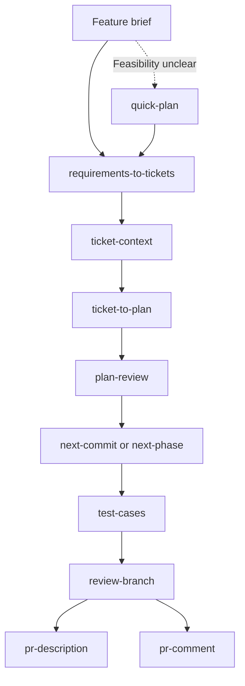

# agent-toolkit

agent-toolkit provides installable skills for concise communication, coding
standards, planning, implementation, and review, with support for Claude and Codex.

## Quick start

**Prerequisites:** Git, Bash, Make, `shasum`, and an installed, signed-in Codex or
Claude Code client. Run the following in a macOS or Linux terminal:

```bash
git clone https://github.com/EimantasZilis/agent-toolkit.git
cd agent-toolkit
make install
```

Choose `codex` or `claude` when prompted. Fresh defaults install the starter
bundle (`concise-output` and `commit-message`), keep Markdown output in the
repository, and leave global guidance unchanged. The installer previews changes
before writing files. Keep this clone: supporting files link back to it.

Start a new session and try `$concise-output` in Codex or `/concise-output` in
Claude Code. See the [worked examples](EXAMPLES.md) for sample prompts.

## Highlights

- **Clear writing:** concise answers, PR descriptions, and commit messages.
- **Coding standards:** guidance for Python, JavaScript, TypeScript, Go,
  Ruby/Rails, and Bash.
- **Planning:** feasibility checks, tickets, and implementation plans.
- **Implementation:** one planned unit or a full phase at a time.
- **Review:** code review, security assessment, and manual test cases.

## Skill catalog

| Category | Pack | Purpose |
| --- | --- | --- |
| coding | [bash-standards](.agents/skills/coding/bash-standards/SKILL.md) | Routed Bash engineering guidance. |
| coding | [define-coding-standards](.agents/skills/coding/define-coding-standards/SKILL.md) | Build a language standards pack. |
| coding | [golang-standards](.agents/skills/coding/golang-standards/SKILL.md) | Routed Go engineering guidance. |
| coding | [javascript-standards](.agents/skills/coding/javascript-standards/SKILL.md) | Routed JavaScript engineering guidance. |
| coding | [python-standards](.agents/skills/coding/python-standards/SKILL.md) | Routed Python engineering guidance. |
| coding | [ruby-standards](.agents/skills/coding/ruby-standards/SKILL.md) | Routed Ruby engineering guidance. |
| coding | [ruby-rails-standards](.agents/skills/coding/ruby-rails-standards/SKILL.md) | Routed Ruby on Rails engineering guidance. |
| coding | [typescript-standards](.agents/skills/coding/typescript-standards/SKILL.md) | Routed TypeScript engineering guidance. |
| implementation | [plan-execution-conventions](.agents/skills/implementation/plan-execution-conventions/SKILL.md) | Interpret existing plans, validate completion, and track execution progress. |
| implementation | [next-commit](.agents/skills/implementation/next-commit/SKILL.md) | Implement one planned unit without committing. |
| implementation | [next-phase](.agents/skills/implementation/next-phase/SKILL.md) | Validate and commit each implementation unit locally; keep planning progress uncommitted unless requested. |
| other | [developer-highlights](.agents/skills/other/developer-highlights/SKILL.md) | Evidence-based career narrative from git history. |
| productivity | [commit-message](.agents/skills/productivity/commit-message/SKILL.md) | Short commit message from staged changes and available conversation context. |
| productivity | [concise-output](.agents/skills/productivity/concise-output/SKILL.md) | Direct, complete reader-facing prose. |
| productivity | [pr-description](.agents/skills/productivity/pr-description/SKILL.md) | Copy-ready pull-request description. |
| productivity | [pr-comment](.agents/skills/productivity/pr-comment/SKILL.md) | Concise, human response to pull-request feedback. |
| productivity | [to-clipboard](.agents/skills/productivity/to-clipboard/SKILL.md) | Copy the previous response to the clipboard as Markdown. |
| productivity | [to-markdown](.agents/skills/productivity/to-markdown/SKILL.md) | Save the previous response as a formatted Markdown file. |
| review | [plan-review](.agents/skills/review/plan-review/SKILL.md) | Gate plans before implementation. |
| review | [annotate](.agents/skills/review/annotate/SKILL.md) | Explain branch changes in terminal output without modifying files. |
| review | [review-branch](.agents/skills/review/review-branch/SKILL.md) | Evidence-based review of committed branch changes. |
| scoping | [plan-writing-conventions](.agents/skills/scoping/plan-writing-conventions/SKILL.md) | Define plan structure, atomic scope, validation, and risks. |
| scoping | [quick-plan](.agents/skills/scoping/quick-plan/SKILL.md) | Investigate feasibility and give one recommendation without implementation or a commit plan. |
| scoping | [requirements-to-tickets](.agents/skills/scoping/requirements-to-tickets/SKILL.md) | Turn feature briefs into small, self-contained backlog tickets. |
| scoping | [ticket-context](.agents/skills/scoping/ticket-context/SKILL.md) | Build a repository-backed context brief for a ticket. |
| scoping | [ticket-to-plan](.agents/skills/scoping/ticket-to-plan/SKILL.md) | Turn a file, chat, or Jira ticket into an implementation-ready planning folder. |
| scoping | [test-cases](.agents/skills/scoping/test-cases/SKILL.md) | Create prioritized Markdown manual test cases for branch changes. |
| security | [security-check](.agents/skills/security/security-check/SKILL.md) | Short fix, accept, or monitor decision. |
| security | [security-review](.agents/skills/security/security-review/SKILL.md) | Detailed security assessment. |

See [CONTRIBUTING.md](CONTRIBUTING.md) for layout and validation rules.

## Chaining skills for software development

Choose the steps your change needs:



- `next-commit` implements one planned unit without committing.
- `next-phase` completes a phase with local commits.
- `review-branch` reviews committed changes.
- Use coding standards and security review where relevant.
- Optional conventions and standards apply when installed; workflows otherwise
  use local defaults and repository guidance.
- PR-writing skills return Markdown. Use `to-clipboard` separately to copy it.

See the [worked workflow](EXAMPLES.md#chain-skills-from-a-feature-brief-to-delivery)
for a full example.

## Installation instructions

| Option | Best for | Updates managed by |
| --- | --- | --- |
| Repository installer | Selected skills and optional global guidance; requires this clone | `make install` |
| [Native plugins](docs/native-packages.md) | Skills packaged independently of the clone | Claude or Codex plugin management |

### Select skills

Run `make install` and choose a bundle or space-separated skill names:

| Selection | Includes |
| --- | --- |
| `starter` | `concise-output` and `commit-message` |
| `all` | Full catalog |
| Category, such as `coding` | All skills in that category |
| Skill names | Only those skills and their required helpers |

Required helpers are included automatically: `plan-review` for `ticket-to-plan`
and `ruby-standards` for `ruby-rails-standards`. Optional skills are separate.

For non-interactive installation:

```bash
./scripts/install.sh --list
./scripts/install.sh --provider codex --bundle starter --no-global-guidance --dry-run
./scripts/install.sh --provider claude --skill pr-description --no-global-guidance
./scripts/install.sh --provider codex --bundle all --global-guidance
```

Repeat `--skill` for multiple skills, or use `--bundle`. CLI options override saved
settings; unspecified settings use saved values or defaults. `--list` and
`--dry-run` write nothing. Install separately for each provider.

### Installed files and guidance

| Provider | Skills | Global guidance |
| --- | --- | --- |
| Codex | `${AGENTS_HOME:-~/.agents}/skills/agent-toolkit/` | `${CODEX_HOME:-~/.codex}/AGENTS.md` |
| Claude | `${CLAUDE_HOME:-~/.claude}/skills/<skill-name>/` | `${CLAUDE_HOME:-~/.claude}/CLAUDE.md` |

- Skills have a generated `SKILL.md`; supporting files link to this clone.
- Optional global guidance covers coding, plain English documentation, and
  Markdown output. Its source is [instructions.md](.agents/global/instructions.md).
- Existing user content is preserved. Edited skills and guidance become
  user-owned and are preserved on later installs.
- Disabling global guidance leaves any previously installed guidance in place.
- Installing `concise-output` alone does not make it a standing instruction.

### Configuration

The installer saves successful choices to `.env` and reuses them next time.
Older configurations without selection or guidance settings retain `all` and
enabled guidance.

Successful installs also record shared preferences in `config/settings.env` and
actual installed skills for each provider in `config/inventory.json`. These
ignored files stay under this toolkit clone, regardless of the caller's working
directory. Existing installations are imported without removing skills; provider
ownership markers still determine which files the toolkit may change.

| Setting | Values | Purpose |
| --- | --- | --- |
| `LLM_PROVIDER` | `codex`, `claude` | Installation provider |
| `SKILL_SELECTION` | Bundle or space-separated skill names | Requested skills |
| `GLOBAL_GUIDANCE` | `True`, `False` | Update global guidance |
| `MARKDOWN_OUTPUT_PATH` | Blank or absolute path | Repository or central Markdown storage |
| `CONCISE_OUTPUT` | `True`, `False` | Standing concise output with global guidance; includes the skill |

Use `AGENT_TOOLKIT_ENV_FILE` for a different settings file, including separate
provider selections. `MARKDOWN_OUTPUT_PATH` also accepts a temporary environment
override without changing the saved setting.

| Output mode | Artifact location |
| --- | --- |
| Repository (default) | `<repo-root>/<branch-slug>/<skill-name>/...` |
| Central | `<output-root>/<repo-slug>/<branch-slug>/<skill-name>/...` |

Explicit paths take precedence. Slugs use lowercase names with unsafe characters
replaced by `-`; detached HEADs use `detached-<short-sha>`. Artifacts are not
committed or removed automatically.

Skills look for earlier workflow output in this order:

1. An explicit path.
2. The current repository and branch's producer-skill directory.
3. Its configured central equivalent.
4. A documented legacy location.

### Update

Pull changes, then reinstall for each provider:

```bash
git pull --ff-only
make install
```

For saved settings without prompts, use `./scripts/install.sh --provider codex`
(or `claude`). Restart the client session afterward.

Choosing fewer skills does not remove earlier installs. The former
`plan-conventions` skill also remains installed; its replacements are
`plan-writing-conventions` and `plan-execution-conventions`.

### Troubleshooting

| Problem | Action |
| --- | --- |
| Missing skill | Check provider and selection with `--dry-run`, then start a new session. |
| User-owned skill skipped | Keep your version or move it aside before reinstalling. |
| Broken supporting-file links | Restore the clone or reinstall from its new location. |
| Missing legacy output setting | Rerun interactive installation or add `MARKDOWN_OUTPUT_PATH=` to `.env`. |
| Failed installation | Changes roll back; if recovery fails, the error gives the backup location. |

## Uninstall

```bash
make uninstall
```

Removes managed skills and guidance for both providers and the installer's
settings file. User-owned skills and configuration are preserved.

## Contributing

See [CONTRIBUTING.md](CONTRIBUTING.md) for repository rules. Run `make verify`
to check the catalog, packages, and isolated installations for both providers.
