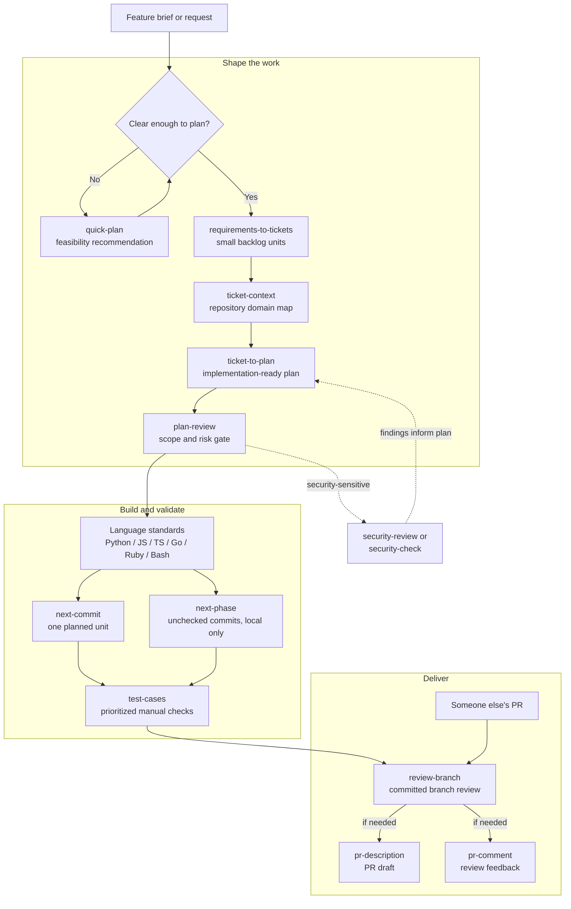

# agent-toolkit

agent-toolkit provides installable skills for concise communication, coding
standards, planning, implementation, and review, with support for Claude and Codex.

## Quick start

**Prerequisites:** Git, Bash, Make, `shasum`, and an installed, signed-in Codex or
Claude Code client. Run the following in a macOS or Linux terminal:

```bash
git clone https://github.com/EimantasZilis/agent-toolkit.git
cd agent-toolkit
make install
```

When prompted, enter `codex` or `claude` for your client. Press Enter at the
remaining prompts to install the starter bundle (`concise-output` and
`commit-message`), keep Markdown output repo-local, and leave global guidance
unchanged. The installer previews selected skills, required helpers, and paths
before writing files. Existing configurations retain their previous full-catalog
and global-guidance defaults. See [installation details](#installation-instructions)
for custom selection. Keep this clone in place: supporting files link back to it.

Check the toolkit's validation and isolated installations for both providers:

```bash
make verify
```

Then start a new session. In Codex, send:

```text
$concise-output Rewrite this update in one sentence: We have now completed the work to fix the login issue, and users are once again able to sign in successfully.
```

In Claude Code, use `/concise-output` followed by the same request.

An example result is:

> The login issue is fixed, and users can sign in again.

Wording may vary; success is a direct, one-sentence update that preserves the
meaning. Try the [worked examples](EXAMPLES.md) next, or choose a skill from
the [catalog](#skill-catalog).

## Highlights

- **Get clearer answers everywhere:** [concise-output](.agents/skills/productivity/concise-output/SKILL.md) leads with the answer, removes repetition, and keeps necessary detail. Recommended for global use.
- **Apply coding standards:** packs for Python, JavaScript, TypeScript, Go, Ruby/Rails, and Bash guide edits and reviews. See [python-standards](.agents/skills/coding/python-standards/SKILL.md) or the [catalog](#skill-catalog).
- **Shape work before coding:** investigate feasibility with [quick-plan](.agents/skills/scoping/quick-plan/SKILL.md), or turn a brief into tickets and a repository-grounded plan with [requirements-to-tickets](.agents/skills/scoping/requirements-to-tickets/SKILL.md) → [ticket-to-plan](.agents/skills/scoping/ticket-to-plan/SKILL.md).
- **Implement in controlled steps:** [next-commit](.agents/skills/implementation/next-commit/SKILL.md) implements and validates one planned unit; [next-phase](.agents/skills/implementation/next-phase/SKILL.md) completes a phase with local commits.
- **Check readiness to merge:** [review-branch](.agents/skills/review/review-branch/SKILL.md) reports actionable findings with evidence; [test-cases](.agents/skills/scoping/test-cases/SKILL.md) prepares prioritized manual checks.
- **Explain the change clearly:** [pr-description](.agents/skills/productivity/pr-description/SKILL.md) drafts the problem and delivered behavior; [commit-message](.agents/skills/productivity/commit-message/SKILL.md) summarizes staged changes.

See the [examples guide](EXAMPLES.md) for prompts, before/after excerpts, and a
workflow from feature brief to PR description.

## Skill catalog

| Category | Pack | Purpose |
| --- | --- | --- |
| coding | [bash-standards](.agents/skills/coding/bash-standards/SKILL.md) | Routed Bash engineering guidance. |
| coding | [define-coding-standards](.agents/skills/coding/define-coding-standards/SKILL.md) | Build a language standards pack. |
| coding | [golang-standards](.agents/skills/coding/golang-standards/SKILL.md) | Routed Go engineering guidance. |
| coding | [javascript-standards](.agents/skills/coding/javascript-standards/SKILL.md) | Routed JavaScript engineering guidance. |
| coding | [python-standards](.agents/skills/coding/python-standards/SKILL.md) | Routed Python engineering guidance. |
| coding | [ruby-standards](.agents/skills/coding/ruby-standards/SKILL.md) | Routed Ruby engineering guidance. |
| coding | [ruby-rails-standards](.agents/skills/coding/ruby-rails-standards/SKILL.md) | Routed Ruby on Rails engineering guidance. |
| coding | [typescript-standards](.agents/skills/coding/typescript-standards/SKILL.md) | Routed TypeScript engineering guidance. |
| implementation | [plan-execution-conventions](.agents/skills/implementation/plan-execution-conventions/SKILL.md) | Interpret existing plans, validate completion, and track execution progress. |
| implementation | [next-commit](.agents/skills/implementation/next-commit/SKILL.md) | Implement one planned unit without committing. |
| implementation | [next-phase](.agents/skills/implementation/next-phase/SKILL.md) | Validate and commit each implementation unit locally; keep planning progress uncommitted unless requested. |
| other | [developer-highlights](.agents/skills/other/developer-highlights/SKILL.md) | Evidence-based career narrative from git history. |
| productivity | [commit-message](.agents/skills/productivity/commit-message/SKILL.md) | Short commit message from staged changes and available conversation context. |
| productivity | [concise-output](.agents/skills/productivity/concise-output/SKILL.md) | Direct, complete reader-facing prose. |
| productivity | [pr-description](.agents/skills/productivity/pr-description/SKILL.md) | Copy-ready pull-request description. |
| productivity | [pr-comment](.agents/skills/productivity/pr-comment/SKILL.md) | Concise, human response to pull-request feedback. |
| productivity | [to-clipboard](.agents/skills/productivity/to-clipboard/SKILL.md) | Copy the previous response to the clipboard as Markdown. |
| productivity | [to-markdown](.agents/skills/productivity/to-markdown/SKILL.md) | Save the previous response as a formatted Markdown file. |
| review | [plan-review](.agents/skills/review/plan-review/SKILL.md) | Gate plans before implementation. |
| review | [annotate](.agents/skills/review/annotate/SKILL.md) | Explain branch changes in terminal output without modifying files. |
| review | [review-branch](.agents/skills/review/review-branch/SKILL.md) | Evidence-based review of committed branch changes. |
| scoping | [plan-writing-conventions](.agents/skills/scoping/plan-writing-conventions/SKILL.md) | Define plan structure, atomic scope, validation, and risks. |
| scoping | [quick-plan](.agents/skills/scoping/quick-plan/SKILL.md) | Investigate feasibility and give one recommendation without implementation or a commit plan. |
| scoping | [requirements-to-tickets](.agents/skills/scoping/requirements-to-tickets/SKILL.md) | Turn feature briefs into small, self-contained backlog tickets. |
| scoping | [ticket-context](.agents/skills/scoping/ticket-context/SKILL.md) | Build a repository-backed context brief for a ticket. |
| scoping | [ticket-to-plan](.agents/skills/scoping/ticket-to-plan/SKILL.md) | Turn a file, chat, or Jira ticket into an implementation-ready planning folder. |
| scoping | [test-cases](.agents/skills/scoping/test-cases/SKILL.md) | Create prioritized Markdown manual test cases for branch changes. |
| security | [security-check](.agents/skills/security/security-check/SKILL.md) | Short fix, accept, or monitor decision. |
| security | [security-review](.agents/skills/security/security-review/SKILL.md) | Detailed security assessment. |

See [CONTRIBUTING.md](CONTRIBUTING.md) for layout and validation rules.

Global coding guidance requires readable spacing across all languages and
standards packs: separate logical groups with blank lines, keep related lines
together, and follow language conventions and the repository's formatter.

## Chaining skills for software development

Chain skills by passing each result to the next step. Follow the
[worked example](EXAMPLES.md#chain-skills-from-a-feature-brief-to-delivery), or
choose the steps your change needs:



Use `next-commit` for one unit or `next-phase` for a full phase. Apply relevant
coding standards and add security review where needed. Commit implementation
changes before `review-branch`, which reviews committed changes only.

Plan creation and execution conventions are separate optional skills.
Global guidance contains the detailed optional-integration policy; each relevant
skill also carries one compact rule so it works without global configuration.
 - `ticket-to-plan` uses installed `plan-writing-conventions`; `next-commit` and
`next-phase` use installed `plan-execution-conventions`. Without them, each
workflow silently uses its local plan-format and execution defaults. Execution
and branch review similarly use installed language standards when available,
otherwise follow repository guidance and existing checks. Explicit repository
requirements remain binding. Plans remain usable without their producer skill.

PR-writing skills return copy-ready Markdown without changing the clipboard;
request `to-clipboard` separately when needed. An inconclusive `security-check`
recommends a broader `security-review` without automatically starting it.

## Installation instructions

### Installation

Install and verify:

```bash
make install
make verify
```

Choose `starter`, `all`, or space-separated skill names when prompted. Required
helpers are included automatically; suggestions for a subsequent workflow are
not. Required helpers are `plan-review` for `ticket-to-plan` and `ruby-standards`
for `ruby-rails-standards`. Optional conventions and language standards are not
installed automatically. Ruby alone does not install Rails guidance. The preview
distinguishes requested skills, dependencies, and skipped user-owned skills.

Category names from the catalog (for example, `coding` or `review`) also select
bundles, through the prompt or `--bundle coding`. Categories and `all` follow
the source tree; `.agents/bundles.txt` defines the stable starter selection.
`scripts/catalog.sh` exposes tab-separated name/category/source-key records,
bundle names, and requested membership. `resolve_selection` in
`scripts/selection.sh` adds the deduplicated transitive dependency closure from
`.agents/dependencies.txt`. Skill directory basenames are stable identities;
duplicate identities and invalid bundle entries fail `make validate`. These
contracts are shared by packaging and the future managed backend. Native build
output is separate from installed provider state and saved installer settings.

For explicit, non-interactive selection, use the script directly:

```bash
# Inspect the catalog and preview a small installation.
./scripts/install.sh --list
./scripts/install.sh --provider codex --bundle starter --no-global-guidance --dry-run

# Install one standalone skill for Claude.
./scripts/install.sh --provider claude --skill pr-description --no-global-guidance

# Install several skills for Codex, leaving global guidance untouched.
./scripts/install.sh --provider codex --skill commit-message --skill to-markdown --no-global-guidance

# Opt into the full catalog and managed global guidance.
./scripts/install.sh --provider codex --bundle all --global-guidance
```

Repeat `--skill` to select multiple skills; it cannot be combined with `--bundle`.
CLI options override saved settings. With options supplied, unspecified settings
use saved values or defaults without prompting. Install for each provider
separately if you use both. `--list` and `--dry-run` do not write files or settings.

Installation paths depend on the provider:

| LLM Provider | Skills | Global config | Provider-specific metadata |
| --- | --- | --- | --- |
| Codex | `${AGENTS_HOME:-~/.agents}/skills/agent-toolkit/` | `${CODEX_HOME:-~/.codex}/AGENTS.md` | Symlinked from `.agents/providers/codex/` |
| Claude | `${CLAUDE_HOME:-~/.claude}/skills/<skill-name>/` | `${CLAUDE_HOME:-~/.claude}/CLAUDE.md` | None |

### How it works

`make install` renders selected skills and their required dependencies for the
chosen provider. Pre-existing user-owned skills with matching names are skipped.

- Each skill gets a provider-rendered `SKILL.md`; supporting files are
  symlinked back to `.agents/skills/`.
- Global guidance is optional. When enabled, managed guidance sits between
  `<!-- agent-toolkit:start -->` and `<!-- agent-toolkit:end -->` markers while
  preserving existing content. When disabled, global files and their ownership
  markers are left untouched, including previously installed guidance.
- Skills that write or discover Markdown carry their task-specific output rules
  even without global guidance. Installing `concise-output` alone does not make
  it a standing instruction for every session.
- If managed guidance or a skill is edited, it becomes user-owned and is
  preserved on later installs.

### Configuration

Interactive `make install` prompts for settings and saves them to `.env` only
after successful installation. Fresh defaults are `codex`, the starter bundle,
repo-local Markdown output, and disabled global guidance. Legacy `.env` files
without selection and guidance settings default to `all` and enabled guidance.
Later installs default to saved choices.

| Setting in `.env` | Valid values | Controls |
| --- | --- | --- |
| `LLM_PROVIDER` | `codex`, `claude` | Selects the provider used for installation. |
| `SKILL_SELECTION` | `starter`, `all`, or space-separated names | Selects requested skills; required dependencies are automatic. |
| `GLOBAL_GUIDANCE` | `True`, `False` | Whether installation updates the provider's global guidance. |
| `MARKDOWN_OUTPUT_PATH` | blank or an absolute path | Selects repo-local or centralized Markdown artifact storage. |
| `CONCISE_OUTPUT` | `True`, `False` | Enables standing concise output when global guidance is enabled; automatically includes the skill. |

`AGENT_TOOLKIT_ENV_FILE` selects an alternative settings file.
Each settings file stores one selection; use separate files to retain different
choices for each provider.
`MARKDOWN_OUTPUT_PATH` also accepts an environment override for that invocation;
the override does not replace the saved output path. Provider, selection, and
guidance choices come from CLI options or the settings file.

Skills that write Markdown use the configured output policy unless the user
provides an explicit path. Repo-local artifacts are written to:

```text
<repo-root>/<branch-slug>/<skill-name>/...
```

With `MARKDOWN_OUTPUT_PATH=/absolute/path`, artifacts are written to:

```text
/absolute/path/<repo-slug>/<branch-slug>/<skill-name>/...
```

Repository and branch names are lowercased, unsafe characters become `-`, and
empty slugs fall back to `repo` or `branch`. Detached HEADs use
`detached-<short-sha>`. Markdown artifacts are not automatically committed or
removed by `make uninstall`.

When a skill consumes another skill's Markdown output, it checks an explicit
path first, then the current repository's current-branch producer-skill
directory, then the configured centralized repository/branch/producer-skill
directory, and finally any documented legacy location. Repository-local
lookups are anchored at the Git repository root, not the process working
directory. Skills must not silently cross repository or branch boundaries.

### Updating

Pull updates in this clone, then rerun installation for each provider you use:

```bash
git pull --ff-only
make install
make verify
```

Saved choices become the prompt defaults. To update without prompts, run
`./scripts/install.sh --provider codex` (or `claude`). Selection is additive:
choosing fewer skills does not remove earlier installations. Disabling guidance
also leaves existing guidance in place; use uninstall to remove managed content.

The former `plan-conventions` skill is now `plan-writing-conventions`, with
execution guidance in `plan-execution-conventions`. Previously installed
`plan-conventions` and former required helpers are left in place; this update
does not automatically remove them.

### Troubleshooting

- **Skill missing:** check the selected provider and preview with `--dry-run`.
  Start a new client session after installation and check the matching provider
  path above. Codex uses `$skill-name`; Claude Code uses `/skill-name`.
- **User-owned skill skipped:** the preview identifies name conflicts. Preserve
  your custom version or move it aside yourself before reinstalling.
- **Broken supporting-file links:** restore this clone at its original path or
  reinstall from its new location. Keep the clone after installation.
- **Missing legacy output setting:** run `make install` interactively and choose
  a Markdown output location, or add `MARKDOWN_OUTPUT_PATH=` to the settings file
  for repo-local output.
- **Installation failure:** changes and saved settings roll back. If rollback
  itself fails, the error reports the retained recovery-backup directory.

## Uninstall

Remove managed skills and guidance:

```bash
make uninstall
```

Uninstall checks both providers and preserves user-owned skills and global
configuration. It also removes the installer's `.env` file, including one
selected through `AGENT_TOOLKIT_ENV_FILE`.

