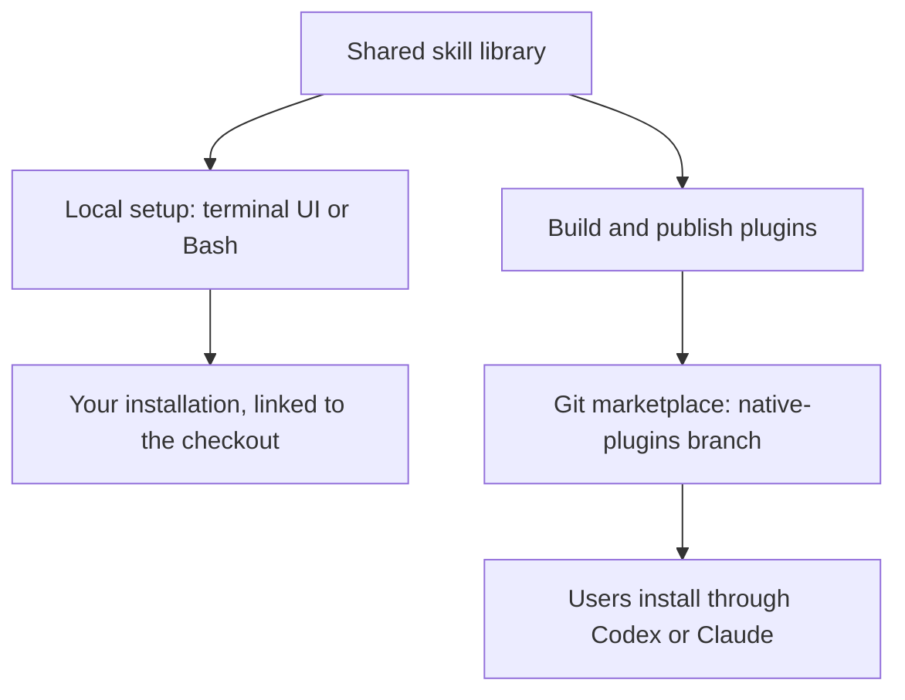
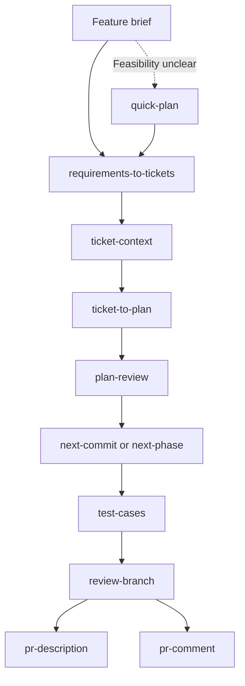

# agent-toolkit

agent-toolkit provides installable skills for concise communication, coding
standards, planning, implementation, and review, with support for Claude and Codex.

## How the repo fits together

Write each skill once in `.agents/skills/`, then install it locally or publish
it as a native plugin. Provider adapters handle the differences between Codex
and Claude.



The terminal UI and Bash commands share one installation engine. Keep the
checkout for local installations; hosted plugins contain their supporting files
and are managed through the provider. Prefer one installation route per skill
to avoid duplicate copies.

## Quick start

**Prerequisites:** Git, Bash, Make, `shasum`, and an installed, signed-in Codex or
Claude Code client. Run the following in a macOS or Linux terminal:

```bash
git clone https://github.com/EimantasZilis/agent-toolkit.git
cd agent-toolkit
make install
```

Terminal `make install` opens the [setup TUI](docs/tui.md) from the current
checkout. It also requires Go at the version declared in `go.mod` (currently
1.27.3). The first launch may download modules and a compatible toolchain;
subsequent launches use Go’s build cache and include source changes automatically.
Use `make install-cli` for Bash setup without Go. Keep this clone for the
backend and linked resources.

In Bash, choose `codex` or `claude` when prompted. Fresh defaults install the
starter bundle (`concise-output` and `commit-message`), keep Markdown output in the
repository, and leave global guidance unchanged. The installer previews changes
before writing files. Keep this clone: supporting files link back to it.

Start a new session and try `$concise-output` in Codex or `/concise-output` in
Claude Code. See the [worked examples](EXAMPLES.md) for sample prompts.

## Everyday workflow

1. **Create or improve a skill** in `.agents/skills/`. Keep its instructions
   usable by both providers and follow [CONTRIBUTING.md](CONTRIBUTING.md).
2. **Validate it** with `make verify` and try the changed behavior in an agent
   session.
3. **Use it locally:** select it through `make install` or `make install-cli`.
   After pulling later changes, use `make update` to refresh saved selections.
   Start a new agent session afterward.
4. **Publish when ready:** generate and validate a versioned snapshot, review
   it in a separate publication checkout, then publish to `native-plugins`
   with a version tag. Follow the [publication guide](docs/native-publication.md).

Local changes do not automatically update published plugins. Publishing is a
separate release decision.

## Highlights

- **Clear writing:** plain English answers and documentation, with details
  introduced gradually.
- **Coding standards:** guidance for Python, JavaScript, TypeScript, Go,
  Ruby/Rails, and Bash.
- **Planning:** feasibility checks, tickets, and implementation plans.
- **Implementation:** one planned unit or a full phase at a time.
- **Review:** code review, security assessment, and manual test cases.

## Skill catalog

| Category | Pack | Purpose |
| --- | --- | --- |
| coding | [bash-standards](.agents/skills/coding/bash-standards/SKILL.md) | Routed Bash engineering guidance. |
| coding | [define-coding-standards](.agents/skills/coding/define-coding-standards/SKILL.md) | Build a language standards pack. |
| coding | [golang-standards](.agents/skills/coding/golang-standards/SKILL.md) | Routed Go engineering guidance. |
| coding | [javascript-standards](.agents/skills/coding/javascript-standards/SKILL.md) | Routed JavaScript engineering guidance. |
| coding | [python-standards](.agents/skills/coding/python-standards/SKILL.md) | Routed Python engineering guidance. |
| coding | [ruby-standards](.agents/skills/coding/ruby-standards/SKILL.md) | Routed Ruby engineering guidance. |
| coding | [ruby-rails-standards](.agents/skills/coding/ruby-rails-standards/SKILL.md) | Routed Ruby on Rails engineering guidance. |
| coding | [typescript-standards](.agents/skills/coding/typescript-standards/SKILL.md) | Routed TypeScript engineering guidance. |
| implementation | [plan-execution-conventions](.agents/skills/implementation/plan-execution-conventions/SKILL.md) | Interpret existing plans, validate completion, and track execution progress. |
| implementation | [next-commit](.agents/skills/implementation/next-commit/SKILL.md) | Implement one planned unit without committing. |
| implementation | [next-phase](.agents/skills/implementation/next-phase/SKILL.md) | Validate and commit each implementation unit locally; keep planning progress uncommitted unless requested. |
| other | [developer-highlights](.agents/skills/other/developer-highlights/SKILL.md) | Evidence-based career narrative from git history. |
| productivity | [commit-message](.agents/skills/productivity/commit-message/SKILL.md) | Short commit message from staged changes and available conversation context. |
| productivity | [concise-output](.agents/skills/productivity/concise-output/SKILL.md) | Readable, concise prose that explains the outcome before the details. |
| productivity | [pr-description](.agents/skills/productivity/pr-description/SKILL.md) | Copy-ready pull-request description. |
| productivity | [pr-comment](.agents/skills/productivity/pr-comment/SKILL.md) | Concise, human response to pull-request feedback. |
| productivity | [to-clipboard](.agents/skills/productivity/to-clipboard/SKILL.md) | Copy the previous response to the clipboard as Markdown. |
| productivity | [to-markdown](.agents/skills/productivity/to-markdown/SKILL.md) | Save the previous response as a formatted Markdown file. |
| review | [plan-review](.agents/skills/review/plan-review/SKILL.md) | Review plan readiness . |
| review | [annotate](.agents/skills/review/annotate/SKILL.md) | Explain branch changes in terminal output without modifying files. |
| review | [review-branch](.agents/skills/review/review-branch/SKILL.md) | Evidence-based review of committed branch changes. |
| scoping | [plan-writing-conventions](.agents/skills/scoping/plan-writing-conventions/SKILL.md) | Define plan structure, scope, validation, and risks. |
| scoping | [quick-plan](.agents/skills/scoping/quick-plan/SKILL.md) | Investigate feasibility and give one recommendation without implementation or a commit plan. |
| scoping | [requirements-to-tickets](.agents/skills/scoping/requirements-to-tickets/SKILL.md) | Turn feature briefs into small, self-contained tickets. |
| scoping | [ticket-context](.agents/skills/scoping/ticket-context/SKILL.md) | Build a repository-backed context brief for a ticket. |
| scoping | [ticket-to-plan](.agents/skills/scoping/ticket-to-plan/SKILL.md) | Turn a file, chat, or Jira ticket into an implementation-ready planning folder. |
| scoping | [test-cases](.agents/skills/scoping/test-cases/SKILL.md) | Create prioritized Markdown manual test cases for branch changes. |
| security | [security-check](.agents/skills/security/security-check/SKILL.md) | Short fix, accept, or monitor decision. |
| security | [security-review](.agents/skills/security/security-review/SKILL.md) | Detailed security assessment. |

See [CONTRIBUTING.md](CONTRIBUTING.md) for layout and validation rules.

## Chaining skills for software development

Choose the steps your change needs:



- `next-commit` implements one planned unit without committing.
- `next-phase` completes a phase with local commits.
- `review-branch` reviews committed changes.
- Use coding standards and security review where relevant.
- Optional conventions and standards apply when installed; workflows otherwise
  use local defaults and repository guidance.
- PR-writing skills return Markdown. Use `to-clipboard` separately to copy it.

See the [worked workflow](EXAMPLES.md#chain-skills-from-a-feature-brief-to-delivery)
for a full example.

## Installation instructions

| Option | Best for | Updates managed by |
| --- | --- | --- |
| Repository installer | Selected skills and optional global guidance; requires this clone | `make update` |
| [Native plugins](docs/native-packages.md) | Skills packaged independently of the clone | Claude or Codex plugin management |

Generate [combined Git marketplace snapshots](docs/native-packages.md#combined-git-marketplace-snapshots)
for [manual publication](docs/native-publication.md). Hosted client acceptance
is separate from local package validation.

The [hosted Codex CLI journey](docs/native-packages.md#codex-cli) is verified on
CLI `0.167.0` for installation, skill/helper sessions, existing-install updates,
removal, and recovery. See the [evidence](docs/native-packages-evidence.md#hosted-codex-runtime-acceptance)
for the tested versions and limitations. Claude client acceptance remains pending.

### Select skills

Run `make install-cli` and choose a bundle or space-separated skill names:

| Selection | Includes |
| --- | --- |
| `starter` | `concise-output` and `commit-message` |
| `all` | Full catalog |
| Category, such as `coding` | All skills in that category |
| Skill names | Only those skills and their required helpers |

Required helpers are included automatically: `plan-review` for `ticket-to-plan`
and `ruby-standards` for `ruby-rails-standards`. Optional skills are separate.

For non-interactive installation:

```bash
./scripts/install.sh --list
./scripts/install.sh --provider codex --bundle starter --full-template false --concise false --dry-run
./scripts/install.sh --provider claude --skill pr-description --full-template false --concise false
./scripts/install.sh --provider codex --bundle all --full-template true --concise true
```

Non-terminal `make install` and `scripts/setup.sh` with arguments also use Bash
without invoking Go. If source setup fails, diagnostics remain visible and
setup stops; use `make install-cli` to continue with Bash.

Repeat `--skill` for multiple skills, or use `--bundle`. CLI options override saved
settings; unspecified settings retain saved values. Fresh Bash setup defaults to
Codex and `starter`. `--list`, `--help`, and `--dry-run` write nothing. Repeat
`--provider` to select both providers in one operation:

```bash
./scripts/install.sh --provider codex --provider claude --bundle starter --dry-run
```

Explicit providers and skills replace their saved selections. Selecting fewer
can remove owned installations. Review `--dry-run` first. A terminal asks for
removal confirmation with a default of No; automation must pass
`--confirm-removals`. Decline or EOF changes nothing.

### Installed files and guidance

| Provider | Skills | Global guidance |
| --- | --- | --- |
| Codex | `${AGENTS_HOME:-~/.agents}/skills/agent-toolkit/` | `${CODEX_HOME:-~/.codex}/AGENTS.md` |
| Claude | `${CLAUDE_HOME:-~/.claude}/skills/<skill-name>/` | `${CLAUDE_HOME:-~/.claude}/CLAUDE.md` |

- Skills have a generated `SKILL.md`; supporting files link to this clone.
- Optional global guidance covers coding and Markdown output. Its writing rules
  apply to all documentation, whether created by a skill or edited directly.
  See [instructions.md](.agents/global/instructions.md).
- Existing user content is preserved. Edited skills and managed guidance blocks cause ownership conflicts.
  The whole operation stops before writes so user changes remain intact.
- Disabling guidance proposes removal of its verified managed block and requires
  confirmation. Surrounding user instructions remain intact.
- Installing `concise-output` alone does not make it a standing instruction.

### Configuration

For explicit reconciliation across providers, use `scripts/managed.sh preview`
with repeated `--provider` and `--skill` arguments. Apply the same selection with
`scripts/managed.sh apply --revision REVISION`, using the revision from preview.
Removals require `--confirm-removals`; conflicts stop the whole apply.
`--no-providers` removes owned installations, and `--remove-skill NAME` removes
an unused skill or helper. Required helpers cannot be removed while selected
skills need them. Native plugins and user-owned files are preserved.
The [versioned backend contract](docs/managed-backend.md) describes its JSON
responses, read-only status/catalog commands, revisions, and errors.

Managed reconciliation accepts `--output-path PATH` (blank for repo-local output)
and `--concise true|false` for shared output and automatic-loading preferences.
The [setup and settings TUI](docs/tui.md) exposes these controls with explicit
page saves, final setup review, and confirmations for removals and directory creation.
Disabling concise loading keeps the skill installed. These controls update only
the toolkit's guidance block and preserve surrounding instructions. The full
global template remains an explicit CLI choice through `--full-template true`.

Bash setup and the TUI use one managed planner and transaction. Successful
applies save desired settings in `config/settings.env` and the observed inventory
in `config/inventory.json`. Both ignored files belong to this clone, independent
of the caller’s directory. Provider files and saved state roll back together.

Setup reads only this canonical state. Without saved state, Bash uses its fresh
defaults and the TUI starts with no provider selected. Use setup options or the
TUI to change saved choices.

| Setting | Values | Purpose |
| --- | --- | --- |
| `PROVIDERS` | Space-separated `codex` and/or `claude` | Desired providers |
| `REQUESTED_SKILLS` | Space-separated skill names | Desired skills; bundles expand when selected |
| `RETAINED_HELPERS` | Skill names | Installed helpers retained after parent removal |
| `GLOBAL_GUIDANCE` | `true`, `false` | Full global template |
| `CONCISE_OUTPUT` | `true`, `false` | Concise loading independently of the full template |
| `MARKDOWN_OUTPUT_PATH` | Blank or absolute path | Repository or central Markdown storage |

Use `--output-path PATH` to save an output root (`''` selects repo-local).
`MARKDOWN_OUTPUT_PATH` remains a temporary rendering override; it does not
replace the saved preference. An explicit `--output-path` takes precedence.
Use `--concise` and `--full-template` to control these settings independently.
An output root can still require a minimal output-policy block.

| Output mode | Artifact location |
| --- | --- |
| Repository (default) | `<repo-root>/<branch-slug>/<skill-name>/...` |
| Central | `<output-root>/<repo-slug>/<branch-slug>/<skill-name>/...` |

Explicit paths take precedence. Slugs use lowercase names with unsafe characters
replaced by `-`; detached HEADs use `detached-<short-sha>`. Artifacts are not
committed or removed automatically.

Skills look for earlier workflow output in this order:

1. An explicit path.
2. The current repository and branch's producer-skill directory.
3. Its configured central equivalent.
4. A documented legacy location.

### Update

Pull changes, then refresh the saved installation:

```bash
git pull --ff-only
make update
```

`make update` uses Bash without Go or selection prompts. It refreshes all saved
providers, skills, retained helpers, and output/guidance preferences. Start new
agent sessions afterward. Preview with `./scripts/update.sh --dry-run`.
Temporary `MARKDOWN_OUTPUT_PATH` overrides are ignored during update; change the
saved preference through setup instead. Provider-home overrides still select
the installation destinations.

Update requires canonical state from a successful setup. It stops
on unknown saved skills, ownership conflicts, proposed removals, or a changed
preview revision. A moved resource can leave a dangling link that ownership
records cannot safely identify; this also requires setup review. Resolve these
through `make install-cli`; preserve user changes. Apply failures roll back provider files and saved state together.

Git pull and refresh are separate operations. Linked resources can change as
soon as Git updates the clone; rollback of a failed refresh cannot undo those
source changes. Keep the checkout available and review source changes before
pulling them. A repeated refresh preserves saved preferences.

Bash and the TUI both reconcile the saved desired selection. Choosing fewer
skills or providers requires confirmation before owned paths are removed.

### Troubleshooting

| Problem | Action |
| --- | --- |
| Missing skill | Check provider and selection with `--dry-run`, then start a new session. |
| Ownership conflict or dangling resource link | Back up the affected installed skill outside the provider skills directory, then review setup. Keep the backup for comparison. |
| Broken supporting-file links | Restore the clone or reinstall from its new location. |
| Failed installation | Changes roll back; if recovery fails, the error gives the backup location. |

## Uninstall

```bash
make uninstall
```

Removes verified managed skills, guidance, and canonical settings in one
transaction. Unrelated user files and native plugins remain.
Ownership conflicts stop uninstall before writes; resolve those conflicts and
retry. Failed uninstall restores provider files and saved state together.

## Contributing

See [CONTRIBUTING.md](CONTRIBUTING.md) for repository rules. Run `make verify`
to check the catalog, packages, and isolated installations for both providers.
