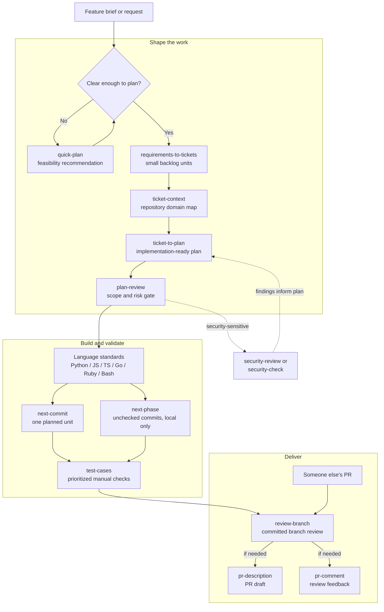

# agent-toolkit

agent-toolkit is a small, installable set of skills for planning, delivery,
security, coding practices, communication, and career retrospectives. It supports
Claude and Codex LLM providers.

## Skill catalog

| Category | Pack | Purpose |
| --- | --- | --- |
| coding | bash-standards | Routed Bash engineering guidance. |
| coding | define-coding-standards | Build a language standards pack. |
| coding | golang-standards | Routed Go engineering guidance. |
| coding | javascript-standards | Routed JavaScript engineering guidance. |
| coding | python-standards | Routed Python engineering guidance. |
| coding | ruby-standards | Routed Ruby engineering guidance. |
| coding | ruby-rails-standards | Routed Ruby on Rails engineering guidance. |
| coding | typescript-standards | Routed TypeScript engineering guidance. |
| review | annotate | Explain branch changes in terminal output without modifying files. |
| implementation | next-commit | Implement one planned unit without committing. |
| implementation | next-phase | Execute every unchecked commit in an active phase, committing locally without pushing. |
| review | review-branch | Evidence-based review of committed branch changes. |
| productivity | pr-description | Copy-ready pull-request description. |
| productivity | pr-comment | Concise, human response to pull-request feedback. |
| productivity | concise-output | Direct, complete reader-facing prose. |
| other | developer-highlights | Evidence-based career narrative from git history. |
| productivity | to-clipboard | Copy the previous response to the clipboard as Markdown. |
| productivity | to-markdown | Save the previous response as a formatted Markdown file. |
| scoping | plan-conventions | Shared planning and progress rules. |
| scoping | quick-plan | Investigate feasibility and give one recommendation without implementation or a commit plan. |
| scoping | requirements-to-tickets | Turn feature briefs into small, self-contained backlog tickets. |
| scoping | ticket-context | Build a repository-backed context brief for a ticket. |
| scoping | ticket-to-plan | Turn a file, chat, or Jira ticket into an implementation-ready planning folder. |
| review | plan-review | Gate plans before implementation. |
| scoping | test-cases | Create prioritized Markdown manual test cases for branch changes. |
| security | security-check | Short fix, accept, or monitor decision. |
| security | security-review | Detailed security assessment. |

See [CONTRIBUTING.md](CONTRIBUTING.md) for layout and validation rules.


## Chaining skills for software development

Skills are most useful as a workflow, not as isolated prompts. Each one turns
an ambiguous input into a more useful artifact or decision that the next skill
can consume. A typical feature can move from discovery to delivery like this:



The chain is intentionally flexible: use `next-commit` for controlled,
incremental delivery or `next-phase` when the active phase is ready to run;
insert security and coding-standards skills where the change warrants them.
The result is a repeatable handoff between reasoning, repository knowledge,
implementation, and evidence of readiness.


## Installation instructions

### Installation
Install and verify the toolkit via:

```bash
make install
make verify
```

Installed skills are placed depending on your LLM provider.

| LLM Provider | Skills | Global config | Provider-specific metadata |
| --- | --- | --- | --- |
| Codex | `${AGENTS_HOME:-~/.agents}/skills/agent-toolkit/` | `${CODEX_HOME:-~/.codex}/AGENTS.md` | Symlinked from `.agents/providers/codex/` |
| Claude | `${CLAUDE_HOME:-~/.claude}/skills/<skill-name>/` | `${CLAUDE_HOME:-~/.claude}/CLAUDE.md` | None |

### How it works

This repository is the provider-neutral source for the skills. Running `make
install` installs and symlinks the skills below it into the provider's skill
directory and updates `CLAUDE.md` or `AGENTS.md` for global LLM configuration.

Any of user's pre-existing skills with the same names are not overwritten. The
skills with the same name are skipped during an installation.

- Each skill gets a provider-rendered `SKILL.md`; supporting files are
  symlinked back to `.agents/skills/`.
- The installer preserves the pre-existing global configs in `CLAUDE.md` or
 `AGENTS.md`. Ownership markers let installation and uninstall distinguish
  managed files from user changes through `<!-- agent-toolkit:start -->` and
  `<!-- agent-toolkit:end -->` markers.
- If managed guidance or a skill is edited, it becomes user-owned and is
  preserved on later installs.
- `make uninstall` removes only managed skills and marked guidance. Markdown
  artifacts created by skills are not automatically committed or removed.

### Configuration

`make install` creates `.env` from `.env.template` when needed, then asks for
each setting. Press Enter to accept the displayed default: `codex` for
`LLM_PROVIDER`, repo-local output for `MARKDOWN_OUTPUT_PATH`, and `True` for
`CONCISE_OUTPUT`. Existing values are used as the defaults on later installs.

| Environment variable | Valid values | Controls |
| --- | --- | --- |
| `LLM_PROVIDER` | `codex`, `claude` | Selects the provider used for installation. |
| `MARKDOWN_OUTPUT_PATH` | blank or an absolute path | Selects repo-local or centralized Markdown artifact storage. |
| `CONCISE_OUTPUT` | `True`, `False` | Enables or disables the `concise-output` skill in the provider's global configuration. |

Skills that write Markdown use the configured output policy unless the user
provides an explicit path. Repo-local artifacts are written to:

```text
<repo-root>/<branch-slug>/<skill-name>/...
```

With `MARKDOWN_OUTPUT_PATH=/absolute/path`, artifacts are written to:

```text
/absolute/path/<repo-slug>/<branch-slug>/<skill-name>/...
```

Repository and branch names are lowercased, unsafe characters become `-`, and
empty slugs fall back to `repo` or `branch`. Detached HEADs use
`detached-<short-sha>`. Markdown artifacts are not automatically committed or
removed by `make uninstall`.

When a skill consumes another skill's Markdown output, it checks an explicit
path first, then the current repository's current-branch producer-skill
directory, then the configured centralized repository/branch/producer-skill
directory, and finally any documented legacy location. Repository-local
lookups are anchored at the Git repository root, not the process working
directory. Skills must not silently cross repository or branch boundaries.


## Uninstall
To remove this repository's skills without affecting other global skills, run:

```bash
make uninstall
```

Note: this command checks for both claude and codex installations,
so that changing LLM providers does not leave any previous installations behind.
It also removes the `.env` file used by the installer, including a path supplied
through `AGENT_TOOLKIT_ENV_FILE`.

It removes the auto-generated config from global `CLAUDE.md` or `AGENTS.md` without
removing user configs.

