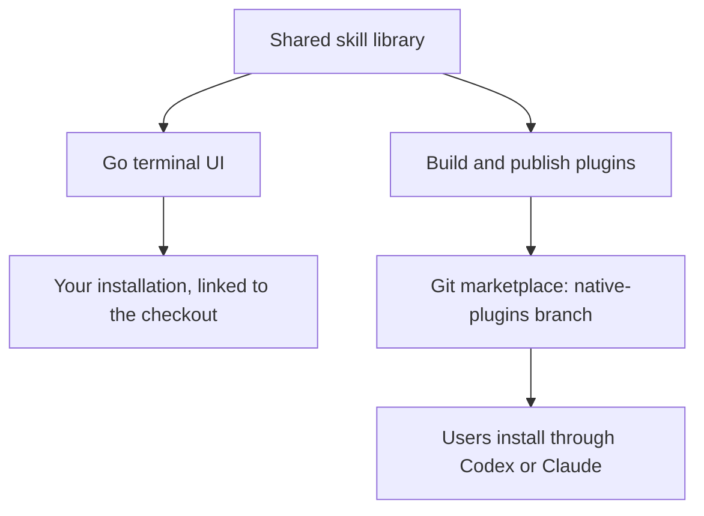

# Repository overview

agent-toolkit maintains one shared skill library for Codex and Claude. You can
use it from a local checkout or distribute it as native plugins, so the same
instructions support personal use and published releases.

## How the repo fits together

Write each skill once in `.agents/skills/`. Provider adapters in
`.agents/providers/` handle the differences between Codex and Claude.

The terminal UI uses the Go installation engine. Shared catalog and rendering
packages support both local installation and native plugin builds.

## Choose an installation route

| Route | How it works | Guide |
| --- | --- | --- |
| Local TUI | Keep a checkout and select skills, global guidance, and Markdown output settings. Supporting files link back to the checkout. | [Local installation](../INSTALL.md) |
| Native plugins | Install through Codex or Claude without a source checkout. Published packages contain their supporting files and are managed through the provider. | [Native plugins](usage/native-packages.md) |

Prefer one installation route per skill to avoid duplicate copies. The native
plugin guide records provider compatibility and runtime verification.

## Develop and publish skills

1. **Create or improve a skill** in `.agents/skills/`. Keep its instructions
   usable by both providers and follow [CONTRIBUTING.md](../CONTRIBUTING.md).
2. **Validate it** with `make verify` and try the changed behavior in an agent
   session.
3. **Use it locally:** select it through `make run`.
   Run `git pull --ff-only` separately, then choose **Refresh installation**
   in the TUI to reapply saved selections.
   Start a new agent session afterward.
4. **Publish when ready:** generate and validate a versioned snapshot, review
   it in a separate publication checkout, then publish to `native-plugins`
   with a version tag. Follow the [publication guide](maintenance/publish-native.md).

Local changes do not automatically update published plugins. Publishing is a
separate release decision.
