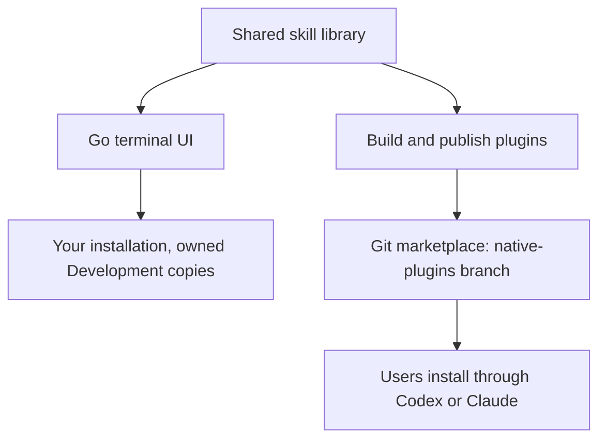

# Repository overview

agent-toolkit maintains one shared skill library for Codex and Claude. You can
use it from a local checkout or distribute it as native plugins, so the same
instructions support personal use and published releases.

## How the repo fits together

Write each skill once in `.agents/skills/`. Provider adapters in
`.agents/providers/` handle the differences between Codex and Claude.

The terminal UI uses the Go installation engine. Shared catalog and rendering
packages support both local installation and native plugin builds.

## Choose an installation route

| Route | How it works | Guide |
| --- | --- | --- |
| Local TUI | Keep a checkout and select skills, global guidance, and Markdown output settings. Instructions and supporting files are copied; source edits take effect through reviewed refresh. | [Local installation](../INSTALL.md) |
| Native plugins | Install through Codex or Claude without a source checkout. Published packages contain their supporting files and are managed through the provider. | [Native plugins](usage/native-packages.md) |

Prefer one installation route per skill to avoid duplicate copies. The native
plugin guide records provider compatibility and runtime verification.

## Develop and publish skills

1. **Create or improve a skill** in `.agents/skills/`. Keep its instructions
   usable by both providers and follow [CONTRIBUTING.md](../CONTRIBUTING.md).
2. **Use it locally without committing:** run `make run` or
   `go run ./cmd/agent-toolkit` from the edited checkout. Select skills initially,
   or choose **Refresh installation** to preserve saved preferences. Review
   changed paths, text, and permissions, then apply.
3. **Test and repeat:** start a new agent session for each selected provider.
   Edit instructions and resources again, review, apply, and test before
   committing. Source edits leave installed copies unchanged until apply. Drafts
   stay selectable; Development requires no eligibility change. Pull upstream
   changes separately when wanted.
4. **Validate and publish when ready:** run `make verify`. Existing native tools
   build and validate packages for publication through a separate checkout to
   `native-plugins`. Follow the [publication guide](maintenance/publish-native.md).

Local changes do not automatically update published plugins. Publishing is a
separate release decision.

Committed, eligible versioned snapshots for the planned lifecycle are future
work. They do not change the current Development loop or existing native tools.
See the [TUI guide](usage/tui.md) for review controls and retry behavior.
