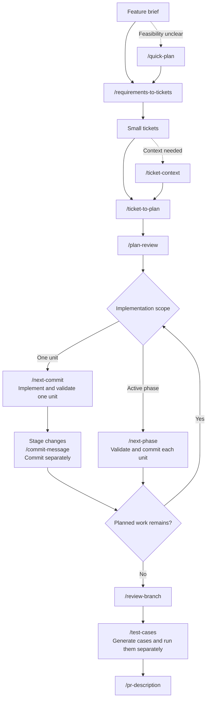

# Skill combinations and development workflows

[Documentation index](../README.md) · [Individual skill examples](../../EXAMPLES.md)

Combine skills when one task produces useful input for another. Use the short
combinations below for everyday tasks, or follow the recommended development
workflow when a change needs planning and implementation.

Prompts use `Use <skill-name> ...` across Codex and Claude Code. Paths and
outcomes are illustrative.

## Small skill combinations

| Task | Requests | Handoff |
| --- | --- | --- |
| Turn a review finding into a focused comment | `Use review-branch against main.` Then: `Use pr-comment to turn the ownership finding above into a concise review comment.` | Evidence from the review becomes a copy-ready comment. It is not posted automatically. |
| Copy a description for publication | `Use pr-description for this change: <change and validation context>.` Then: `Use to-clipboard.` | The complete preceding response is copied as Markdown. Paste and publish it separately. |
| Add repository context to a ticket | `Use ticket-context for <path_or_link_to_ticket>.` Then: `Use ticket-to-plan for <path_or_link_to_ticket>, using <path_or_link_to_context>.` | Domain rules and code paths inform the implementation plan. |

See the skill instructions for
[pr-comment](../../.agents/skills/productivity/pr-comment/SKILL.md),
[to-clipboard](../../.agents/skills/productivity/to-clipboard/SKILL.md), and
[ticket-context](../../.agents/skills/scoping/ticket-context/SKILL.md).

## Recommended development workflow

Skills can carry requirements and repository evidence from a broad brief
through implementation and review. This workflow splits invoice PDFs and
monthly CSV exports into separate tickets, then takes the PDF ticket through
delivery. Start at any step whose input you already have.

### Choose an entry point

- Start with a brief when the work still needs ticket boundaries.
- If feasibility is unclear, use [quick-plan](../examples/quick-plan.md) first.
- Start at planning when you already have a ticket. Add `ticket-context` when
  domain rules or code paths need explanation.
- Start at implementation when you already have a reviewed plan. Small changes
  that do not need a plan can go directly through your normal coding and review
  process.

### Shape and plan the work

| Step | Example request | Result passed to the next step |
| --- | --- | --- |
| 1. [requirements-to-tickets](../../.agents/skills/scoping/requirements-to-tickets/SKILL.md) | Use requirements-to-tickets to split this brief into focused tickets and save them as Markdown: customers can download their own invoice PDFs and export a monthly invoice list as CSV. Exclude bulk PDF downloads. | Separate PDF and CSV tickets with acceptance criteria and dependencies. |
| 2. [ticket-context](../../.agents/skills/scoping/ticket-context/SKILL.md) | Use ticket-context for the PDF ticket at `<ticket>`. Explain invoice ownership, the existing invoice page, and the relevant code paths. | A context brief with repository evidence and unresolved questions. |
| 3. [ticket-to-plan](../../.agents/skills/scoping/ticket-to-plan/SKILL.md) | Use ticket-to-plan for `<ticket>`, using `<context>` as supporting context. Keep monthly CSV export outside this plan. | After confirmation, a planning README and phase files. |
| 4. [plan-review](../../.agents/skills/review/plan-review/SKILL.md) | Included as the ticket-to-plan checkpoint. To review again after revisions: Use plan-review for `<path_to_planning_readme>`. | Findings on scope, dependencies, validation, and risks. Resolve findings and open decisions before implementation. |

Use the PDF ticket in the following steps. Replace `<placeholders>` with the
relevant paths or links. For generated files, use paths reported by earlier skills.

See the [planning example](../examples/ticket-to-plan.md) for an illustrative result.

### Implement and deliver

On a feature branch, `next-commit` keeps implementation bounded to one planned
unit at a time. Validate and commit each unit, then review the completed branch.
After resolving review findings, use `test-cases` to prepare manual checks for
the delivered behavior.

| Step | Example request or action | Result passed to the next step |
| --- | --- | --- |
| 5. [next-commit](../../.agents/skills/implementation/next-commit/SKILL.md) | Use next-commit with `<path_to_planning_readme>`. | Exactly one unchecked unit implemented and validated, with local plan progress updated. No Git commit is created. |
| 6. [commit-message](../../.agents/skills/productivity/commit-message/SKILL.md) | After inspecting and staging the unit: Use commit-message for my staged changes. | A message summarizing the staged implementation. Commit separately; repeat steps 5–6 for remaining units across all phases. |
| 7. [review-branch](../../.agents/skills/review/review-branch/SKILL.md) | Use review-branch against main, using `<ticket>` and `<path_to_planning_readme>` as the specification. | Actionable findings or `No issues found.` Review covers committed changes only. |
| 8. [test-cases](../../.agents/skills/scoping/test-cases/SKILL.md) | After resolving review findings: Use test-cases for the current branch against main, using `<ticket>` and `<path_to_planning_readme>`. Focus on the implemented PDF flows. | Prioritized manual cases for the reviewed change, ready to execute separately. |
| 9. [pr-description](../../.agents/skills/productivity/pr-description/SKILL.md) | Use pr-description for the completed PDF change, using the ticket, committed diff, review findings, and recorded validation results. | A copy-ready description grounded in the delivered behavior and checks actually performed. |

Before preparing the PR description:

1. Fix review findings, validate and commit the fixes, then repeat branch review.
2. Run the generated manual cases against the intended build and record results.
3. If checks fail, fix, validate, and commit the changes. Repeat branch review
   and affected manual checks.

Keep ticket and plan progress out of implementation commits unless requested.

For a larger planned phase, use
[next-phase](../../.agents/skills/implementation/next-phase/SKILL.md) with the
planning README instead of steps 5–6. It implements, validates, stages, and
commits each remaining unit in the active phase, updates local plan progress,
and stops if validation fails. Repeat for each phase, then continue at step 7.

Run tests separately from `review-branch` and
[test-cases](../examples/test-cases.md). Use recorded results in
[pr-description](../examples/pr-description.md). These steps do not push changes
or publish a PR.
